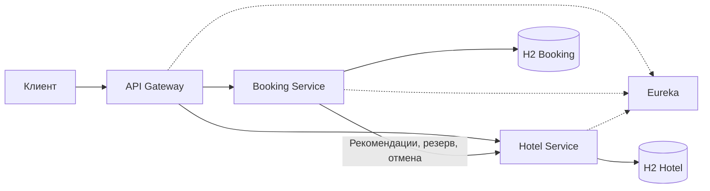

# Архитектура и решения

## Схема данных

| База | Таблица | Связи и ограничения |
|---|---|---|
| Booking | `users` | UUID, уникальное имя, BCrypt-хеш пароля и роль |
| Booking | `bookings` | UUID, владелец `user_id`, выбранный номер, входной идентификатор номера, период, статус и дата создания. Уникальная пара `user_id, request_id`. Индекс истории по владельцу и времени |
| Hotel | `hotels` | ID, название и адрес |
| Hotel | `rooms` | ID, внешний ключ отеля, уникальная пара отель и номер, операционная доступность и число действующих резервов |
| Hotel | `room_slots` | Первичный ключ `booking_id`, номер, даты и признак освобождения. Индекс проверки пересечений по номеру, признаку освобождения и датам |

`bookings.room_id` и `room_slots.booking_id` связывают записи логически.
Booking блокирует пользователя при создании брони и при удалении аккаунта.
Удаление аккаунта с историей возвращает `409`. Hotel блокирует номер при
удалении, резервировании и освобождении. Номер с действующим резервом удалить
нельзя. H2 создаётся заново при перезапуске процесса. При ручном сбросе стенда
перезапускайте оба бизнес-сервиса, чтобы сбросить обе базы одновременно.

## ADR 1. Интервалы и конкурентность

Hotel проверяет даты и сохраняет слот в одной локальной транзакции под блокировкой
строки номера. Используется полуоткрытый интервал `[заезд, выезд)`. Параллельный
запрос ждёт блокировку и проверяет уже обновлённые данные. Флаг `available`
описывает эксплуатационную доступность и проверяется отдельно от календаря.

При автоподборе Hotel возвращает свободные варианты по возрастанию
`times_booked`, затем ID. Если вариант заняли между чтением и попыткой
резерва, Booking проверяет следующий. После неопределённого результата
вызова Booking сначала отменяет бронь и освобождает выбранный номер.
`times_booked` отражает действующие резервы и уменьшается при освобождении.

## ADR 2. Сага и компенсация

1. Booking фиксирует `PENDING` и привязывает клиентский ключ идемпотентности к пользователю.
2. Hotel резервирует даты по `bookingId`. Успех переводит запись Booking в `CONFIRMED`.
3. При ошибке Booking фиксирует `CANCELLED`. Если исход резервирования неизвестен, Booking вызывает `release`.
4. При сбое `release` отметка о необходимой компенсации сохраняется в Booking. Фоновая задача повторяет операцию. Hotel сохраняет признак отмены даже при освобождении до прихода первого резерва, поэтому запоздавший запрос бронь не восстановит.

На вызов к Hotel настроены тайм-ауты подключения и ответа в 1 и 2 секунды,
до трёх попыток с паузами 100 и 200 мс. Circuit Breaker применяется к подбору
и резервированию. Бизнес-ответы `4xx` не открывают его. Освобождение идёт
отдельным путём и может сработать при открытом Circuit Breaker. Гарантии
компенсации действуют, пока данные обеих H2 находятся в памяти.

## ADR 3. Доступ и наблюдаемость

Booking выдаёт пользовательские JWT на час и отдельные служебные токены на минуту.
Gateway принимает пользовательские роли, а каждый бизнес-сервис снова проверяет
подпись и роль. Hotel принимает служебные операции только с ролью `SERVICE`.
Gateway не маршрутизирует вызовы резервирования и освобождения. Секрет HS256
передаётся переменной окружения и общий для доверенных приложений учебного стенда.
Изменение роли применяется к вновь выданным токенам, ранее выданный токен
истекает через час.

Gateway задаёт `X-Trace-Id`, бизнес-сервисы записывают его в контекст журналов.
Через `bookingId` связываются подтверждение, тайм-ауты и компенсация. Для
фоновой компенсации сохраняется идентификатор запроса, который запустил отмену.

## Занятые ночи

Статистика берёт действующие резервы, которые пересекают запрошенный период,
и обрезает каждый интервал по границам этого периода. Загрузка равна сумме
занятых ночей, делённой на число ночей окна. Процент рассчитывается по каждому
номеру, включая номера с нулевой загрузкой. Например, одна бронь на восемь
ночей и три брони на одну ночь за десятидневное окно дают 80% и 30%.
